<!-- INTRODUCTION -->
<h1 align="center">Hi, I'm Harsh Bhukal 👋</h1>

<h3 align="center">
  Aspiring Software Engineer · Full-Stack Developer
</h3>

  Building practical digital products, exploring modern technologies,
  and growing through hands-on engineering.

  
  

---

## About Me

I'm an aspiring Software Engineer and Full-Stack Developer interested in building useful, well-designed applications and understanding how software works beyond the user interface.

- 🎓 Pursuing **B.Sc. Physical Science** at Kamla Memorial Government College, affiliated with CRSU.
- 💻 Working with modern web technologies and full-stack development.
- 🧩 Interested in software engineering, backend systems, and problem-solving.
- 🔬 Building projects that combine software, hardware, and AI integrations.
- 📚 Currently strengthening JavaScript, TypeScript, Next.js, backend engineering, and DSA.
- 🎯 Open to software engineering internships, part-time opportunities, and collaborations.

---

## Tech Stack

### Languages & Core Technologies

  

### Frontend Development

  

### Backend & Database

  

### Tools & Platforms

  

### Currently Exploring

  

---

## Featured Projects

### 01. VeyraSense
**ESP32-Based Physiological Monitoring & AI-Assisted Analysis**

An experimental hardware-software project that integrates pulse and GSR sensors with an ESP32 to collect physiological signals. The web dashboard visualizes incoming data and uses API-based AI integration to provide suggestions and generate reports.

- Assembled and integrated the hardware.
- Worked on sensor integration and system-level development.
- Contributed approximately 85% of the overall project.
- Currently strengthening firmware development.

**Technologies:** ESP32 · Pulse Sensor · GSR Sensor · TypeScript · APIs · AI Integration

[Live Demo](https://veyrasense.vercel.app/) · [GitHub Repository](https://github.com/HarshProDev/veyra-sense)

---

### 02. Harsh Mentor
**Affiliate Marketing & Lead Generation Platform**

A lead-generation website designed to introduce visitors to affiliate marketing and collect potential leads.

- Built the frontend and lead-generation experience.
- Integrated backend API routes and MongoDB Atlas for lead storage.
- Worked on form handling and deployment.

**Technologies:** React · Vite · JavaScript · MongoDB Atlas · Vercel

[Live Demo](https://harshmentor-in.vercel.app/)

---

### 03. Your First Affiliate Step
**Affiliate Marketing Landing Page**

A responsive website designed to help visitors take their first step into affiliate marketing.

- Lead-capture form with name, email, phone number, and discovery platform.
- Integrated Google Sheets for lead storage.
- Deployed using Cloudflare Pages.

**Technologies:** HTML · CSS · JavaScript · Google Sheets · Cloudflare Pages

[Live Demo](https://your-first-affiliate-step-harshmentor-in.pages.dev/)

---

### 04. Happy Teacher's Day
**Interactive Frontend Experience**

A creative web experience built to celebrate and appreciate teachers through an interactive digital presentation.

**Technologies:** TypeScript · Frontend Development

[Live Demo](https://happy-teachers-day-psi.vercel.app/) · [GitHub Repository](https://github.com/HarshProDev/Happy-Teachers-Day)

---

## GitHub Activity

  

  

---

## Beyond Code

I also enjoy exploring creative and entrepreneurial fields:

- 🎨 Visual design and creative experimentation
- 🎬 Video editing and content creation
- 📈 Digital marketing and YouTube marketing
- 🚀 Entrepreneurship and product building

---

## Let's Connect

I'm always interested in learning from other developers, discussing ideas, collaborating on projects, and exploring opportunities in software engineering.

  <a href="https://www.linkedin.com/in/harshbhukal-dev/">
    LinkedIn
  </a>
  &nbsp; · &nbsp;
  <a href="https://github.com/HarshProDev">
    GitHub
  </a>

  <i>Building consistently. Learning continuously. Engineering with purpose.</i>

